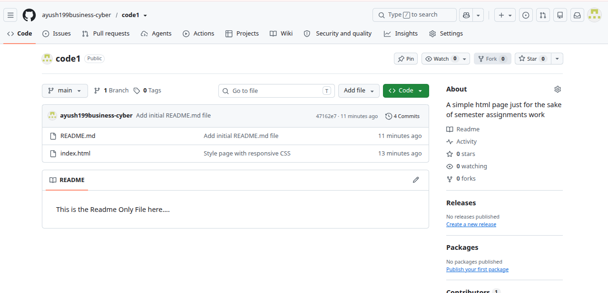
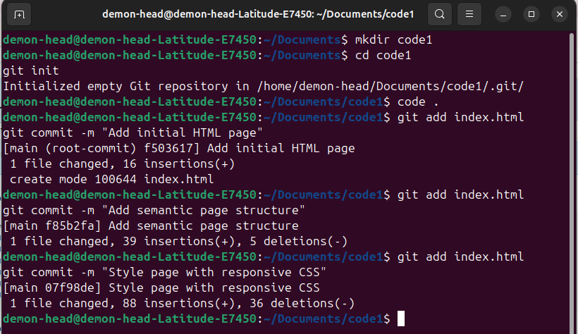
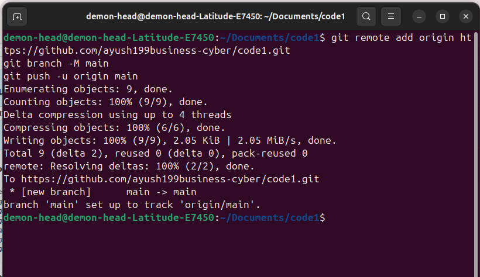
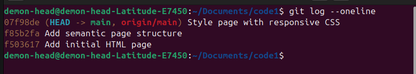

# GitHub Repository Submission

**Student:** Ayush Sharma  
**Course:** BCAI, 1st Year, 1st Semester  
**University:** Invertis University

## GitHub Profile

https://github.com/ayush199business-cyber

## Assignment Repository

Repository name: `code1`

## Push Commands

Replace `https://github.com/ayush199business-cyber/code1.git` with the actual HTTPS URL of the repository you create on GitHub.

```bash
git branch -M main
git remote add origin https://github.com/ayush199business-cyber
git push -u origin main
```

If the remote already exists, check it with `git remote -v` instead of adding it again.

## Submission Evidence

- **Repository created on GitHub.**  
- **Three meaningful commits visible** 
- **Pushing the Code to Github** 
- **Checking the Commit History** 

- **Repository URL:** [https://github.com/ayush199business-cyber/code1]
